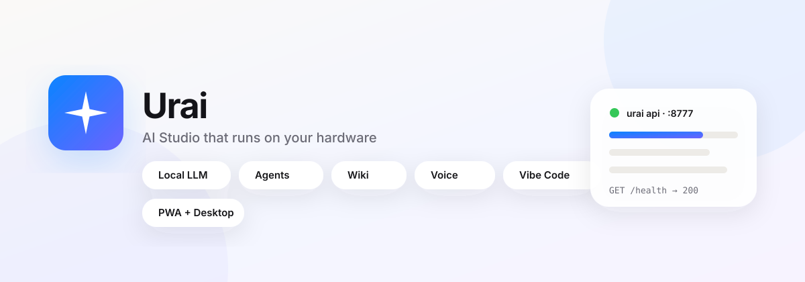

# ✦ Urai — AI That Runs on Your Hardware

<div align="center">

[](https://github.com/etside/urai/actions/workflows/ci.yml)
[](https://github.com/etside/urai/actions/workflows/urai-ci.yml)
[](https://github.com/etside/urai/actions/workflows/desktop.yml)
[](https://etside.github.io/urai/)
[](https://github.com/etside/urai/releases)
[](LICENSE)
[](pyproject.toml)

**[🌐 Live Demo](https://etside.github.io/urai/) · [📖 API Docs](docs/API.md) · [📚 All Docs](docs/README.md) · [🚀 Quick Start](#install) · [📦 Releases](https://github.com/etside/urai/releases) · [📝 Changelog](CHANGELOG.md)**

*Local LLM · Voice · Browser · Wiki · Multi-agent · One install · No cloud required*

</div>

---

## What is Urai?

Urai is a production AI runtime that runs on your own machine. It serves an OpenAI-compatible API, a web studio, and a CLI — all powered by a local Qwen3 model via llama.cpp. No API keys required for the core path.

```bash
# One-line install
curl -fsSL https://raw.githubusercontent.com/etside/urai/main/install.sh | bash

# Start API + web studio
urai api --port 8777
# Open http://localhost:8777/app
```

---

## Features

| Capability | Details |
|---|---|
| **Local LLM** | Qwen3 0.6B–8B via llama.cpp. GPU offload (CUDA/ROCm). No cloud. |
| **OpenAI-compatible API** | `/v1/chat/completions` with streaming, `/v1/models`, `/v1/embeddings` |
| **Voice** | STT: faster-whisper (local) → AWS Transcribe (free tier). TTS: Kokoro → AWS Polly neural |
| **Browser** | Playwright computer-use. Screenshot → perceive → click/type. Session recovery. |
| **Knowledge Wiki** | 3-tier memory: session cache + mid-term sessions + permanent pages. BM25 + vector search. |
| **Named Agents** | Persistent agents with instructions, tools, schedule, private memory |
| **Vibe Code** | NL → write → run → iterate. Tool-guarded. Real projects. |
| **Deep Research** | IterResearch: plan → multi-hop web search → synthesize |
| **Multi-agent** | Swarm, Conductor (PlanningFlow), parallel fan-out |
| **Self-healing** | Watchdog restarts llama-server automatically |
| **Self-improving** | Weekly: probe → distill → bench → promote (no regression gate) |
| **AWS free tier** | S3 backup, DynamoDB persistence, Polly TTS, Transcribe STT, CloudWatch logs |

---

## Install

### One command (Linux / macOS)

```bash
curl -fsSL https://raw.githubusercontent.com/etside/urai/main/install.sh | bash
```

### Docker

```bash
docker run -p 8777:8777 \
  -e URAI_MASTER_KEY=$(openssl rand -hex 32) \
  -e URAI_MODEL=qwen3-4b \
  -v urai-model:/app/model \
  -v urai-data:/app/data \
  ghcr.io/etside/urai:v3
```

### From source

```bash
git clone https://github.com/etside/urai.git && cd urai
pip install -e ".[local]"        # core + local inference
urai model download qwen3-4b     # ~2.3 GB
urai serve start --model qwen3-4b
urai api --port 8777
```

### Desktop app (Windows / Linux)

Download from [Releases](https://github.com/etside/urai/releases):

| Platform | Files |
|---|---|
| Windows | `urai-3.0.0-win-x64.exe` (installer) · `urai-3.0.0-win-x64-portable.exe` |
| Linux | `urai-3.0.0-linux-x86_64.AppImage` · `urai-3.0.0-linux-amd64.deb` |

The desktop shell starts the local API for you, shows the Studio in its own
window and stops the backend on exit. It is a shell, not a Python bundle: install
Urai first with the one-liner above (or `pip install -e .` from a checkout).
Build from source: [desktop/README.md](desktop/README.md).

### Urai's own weights (GGUF)

The Urai-tuned model ships as a release asset (GitHub caps repo files at
100 MB): [urai-qwen3-06b-v1](https://github.com/etside/urai/releases/tag/urai-qwen3-06b-v1).

```bash
urai model download urai-qwen3-06b   # 379 MB Q4_K_M
urai model use urai-qwen3-06b
urai serve start --model urai-qwen3-06b --ctx 8192
```

`urai-qwen3-06b-v1-f16.gguf` (1.2 GB) is the full-precision reference;
`SHA256SUMS.txt` covers both files. The Q4_K_M quant is the same weights
Qwen3-0.6B merged with the Urai distill adapter, converted with llama.cpp's
`convert_hf_to_gguf.py` (b12000) — thinking is off by default, opt in with
`chat_template_kwargs: {"urai_thinking": true}`.

### Runners + weights bundle

`build.yml` produces `urai-bundle-linux-x64` — pinned llama.cpp + sd-cli
binaries and the registry weights, split at 1.9 GB for release hosting.
Reassemble with `python3 scripts/assemble_release.py <dir>`.

### PWA

The Studio is installable from Chromium (desktop or Android): open `/app` and
use **Install** in the toolbar, or the browser's *Install app* menu. The
service worker caches the shell only — API traffic is always live.

---

## Web Studio

Open [http://localhost:8777/app](http://localhost:8777/app) after starting the API,
or try the shell-only demo at **[etside.github.io/urai](https://etside.github.io/urai/)**
(the demo points at your local API on `127.0.0.1:8777`).



Features:
- **Chat** — streaming, vision, thinking mode, `∞ No limit` (8192 tokens)
- **Vibe Code** — describe → write → run loop in the browser
- **Wiki** — search, add, browse knowledge pages
- **Agents** — create and talk to named persistent agents
- **API Keys** — generate, copy, revoke keys with one click (unlimited quota)
- **Settings** — server URL, API key, rate limit status
- **Installable** — PWA manifest + service worker; desktop installers below

```bash
urai studio            # start the API if needed + open the Studio
urai key create laptop # unlimited key, printed once
urai tui               # terminal UI over the same API
```

---

## CLI

```bash
# Chat
urai ask "explain async/await"
urai chat                          # interactive REPL (local llama-server)
urai chat --remote                 # use a remote Urai API (urai login first)

# Studio + terminal UI
urai studio                        # start the API if needed + open the Studio
urai tui                           # interactive text UI over the same API

# Code
urai vibe "build a FastAPI todo app" --workspace ./app
urai vibe "add tests for auth" --plan      # propose writes, do not apply
urai agent "refactor auth module across 3 files"

# Research
urai agent "research the latest developments in Rust, cite sources"

# Vision / image
urai see screenshot.png "what is wrong with this UI?"
urai imagine "a brass owl on a rainy rooftop" -o owl.png

# Wiki
urai wiki search "python async"
urai wiki add "MyTopic" "Content here" --category concepts
urai wiki list

# Agents
urai agents list
urai agents create Researcher --instructions "You research topics deeply" --tools web_search,wiki_search
urai agents run <id> "What is quantum computing?"

# Routines (scheduled, run by the server scheduler)
urai routines create Morning --prompt "Summarise my day" --schedule daily@08:00
urai routines list
urai routines run <id>

# Keys
urai key create my-app            # unlimited quota; printed once
urai key list
urai key revoke urai_xxx

# Model
urai model list
urai model download qwen3-4b
urai model use qwen3-4b

# Serve
urai serve start --model qwen3-4b --ctx 8192
urai serve stop
urai api --host 0.0.0.0 --port 8777
```

---

## API

Urai is fully OpenAI API compatible. Point any OpenAI client at `http://localhost:8777`:

```python
from openai import OpenAI
client = OpenAI(base_url="http://localhost:8777/v1", api_key="your-urai-key")

# Chat
response = client.chat.completions.create(
    model="urai",
    messages=[{"role": "user", "content": "Hello!"}],
    stream=True,
)

# Research
import httpx
r = httpx.post("http://localhost:8777/v1/research", json={"query": "latest AI news"})
print(r.json()["answer"])

# Generate API key
r = httpx.post("http://localhost:8777/v1/keys/generate",
    json={"label": "my-app", "quota": 0},  # 0 = unlimited
    headers={"Authorization": f"Bearer {master_key}"})
print(r.json()["token"])  # copy this once!
```

Full API reference: **[docs/API.md](docs/API.md)**

---

## Configuration

Copy `.env.example` to `.env` and set:

```bash
URAI_MASTER_KEY=<openssl rand -hex 32>    # required in production
URAI_MODEL=qwen3-4b
URAI_PORT=8777
URAI_RATE_LIMIT=60                         # requests per minute per IP
URAI_CACHE_TTL=60                          # response cache TTL seconds

# Optional cloud keys (Urai runs 100% without these)
OPENAI_API_KEY=
ANTHROPIC_API_KEY=
ELEVENLABS_API_KEY=
AWS_DEFAULT_REGION=ap-south-1
```

`.env` is loaded automatically by `urai api`, `urai studio` and the desktop
shell (current directory first, then the repo root). Shell environment
variables always win. `URAI_ENV_FILE=/path/to/file` reads a different file.

All variables are documented in [`.env.example`](.env.example).

---

## Architecture

```
                    ┌─────────────────────────────┐
                    │         Urai v3              │
                    │  ┌───────────────────────┐  │
                    │  │   HTTP API (server.py) │  │
                    │  │  OpenAI-compatible     │  │
                    │  └──────────┬────────────┘  │
         ┌──────────┤             │                ├──────────┐
         │          │  ┌──────────▼────────────┐  │          │
    Web UI        CLI  │     agent.py           │  Android   ACP
  (app.html)  (cli.py) │  PLAN→TOOL→VERIFY      │  (WebView) (OpenLive)
         │          │  └──────────┬────────────┘  │          │
         └──────────┤             │                ├──────────┘
                    │  ┌──────────▼────────────┐  │
                    │  │    router.py           │  │
                    │  │  Always: Urai's model  │  │
                    │  └──────────┬────────────┘  │
                    │             │                │
                    │  ┌──────────▼────────────┐  │
                    │  │  LlamaServerBackend    │  │
                    │  │  (Qwen3 via llama.cpp) │  │
                    │  └───────────────────────┘  │
                    └─────────────────────────────┘
```

Full architecture: **[docs/ARCHITECTURE.md](docs/ARCHITECTURE.md)**

---

## Development

```bash
# Tests
python3 scripts/smoke_urai.py       # offline smoke test (~6s)
pytest tests/ -x -q

# Self-improvement pipeline
python3 scripts/train_pipeline.py --base http://127.0.0.1:8777 --tag weekly

# Distill training data
python3 scripts/distill/run_distill.py --tasks data/raw_tasks/sample_tasks.jsonl --out data/verified/distill-now.jsonl

# Kaggle T4 training (free GPU)
# See docs/INDEPENDENCE.md
```

---

## Deployment

**VPS (recommended):** See [docs/PROD.md](docs/PROD.md) — Caddy + systemd

```bash
# Quick VPS deploy
git clone https://github.com/etside/urai.git /opt/urai
cp /opt/urai/deploy/urai-api.service /etc/systemd/system/
systemctl enable --now urai-api
# Edit /etc/caddy/Caddyfile with your domain
```

**Docker Compose with HTTPS:**
```bash
cd docker
cp .env.example ../.env && nano ../.env  # set URAI_MASTER_KEY
docker compose --profile https up -d
```

---

## Skills

Urai ships 18 skills including ports from [Anthropic's official skills](https://github.com/anthropics/skills):

- `webapp-testing` — Playwright-based UI testing
- `mcp-builder` — Build MCP servers from API specs
- `skill-creator` — Create and evaluate new skills
- `canvas-design` — Design assets and layouts
- `cyber-security` — Security review and threat analysis
- `zen-coder` — High-quality code generation
- `jev-optim` — Performance optimization

See all in [`skills/`](skills/).

---

## License

[Apache 2.0](LICENSE) — free for personal and commercial use.

Built by **Tynio LTD**. Urai, developed by Tynio LTD.
